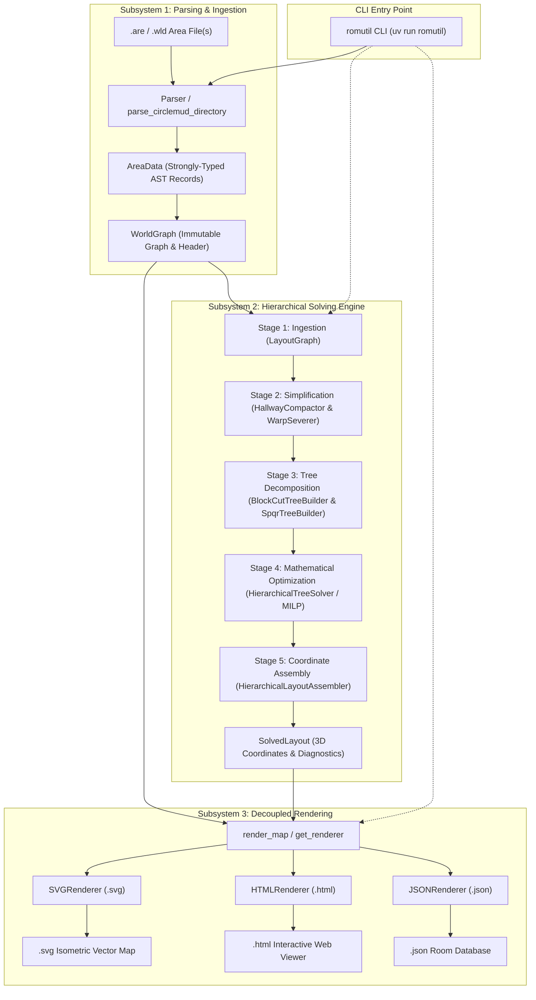
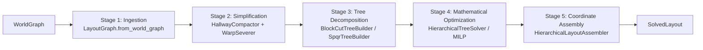

# ROMUtil Architecture & Design Guide

**ROMUtil** is an automated pipeline that parses text-based area files (`.are`, `.wld`) from **ROM (Rivers of MUD / DikuMUD)** codebases and related dialects, calculates consistent 3D geometric coordinates `(x, y, z)` for rooms through hierarchical decomposition and Mixed-Integer Linear Programming (MILP), resolves non-Euclidean contradictions and spatial collisions, and generates interactive isometric SVG map visualizations, structured JSON databases, and standalone web applications.

---

## 1. Problem Space & Challenges

In text-based MUDs, areas were authored manually by human builders over decades. Unlike tile-based maps, MUD areas are arbitrary directed graphs with cardinal and elevation exits:
- **Non-Euclidean Topologies**: Moving East and then West does not guarantee returning to the same room. Loops frequently possess unequal opposing path lengths (e.g., 3 rooms North, 2 rooms East, 2 rooms South, 2 rooms West).
- **Corridors & Mazes**: Long straight hallways cause high solver complexity, while mazes contain deliberate cycles and one-way drops.
- **Verticality (Z-Axis)**: Areas feature multiple elevation levels interconnected by `Up` and `Down` exits.
- **Zone Boundaries**: Exits often point to rooms outside the file (`VNUM`s not in the area) or unresolved destinations (`dst == -1`).
- **Combinatorial Scale**: Flat mathematical optimization across hundreds of interconnected rooms and cycles leads to exponential branch-and-bound search spaces.

ROMUtil resolves these challenges by decoupling the architecture into three discrete subsystems:
1. **Parsing & Ingestion**: Resilient lexing and parsing producing immutable AST records and a unified `WorldGraph`.
2. **Hierarchical Solving Engine**: A 5-stage decomposition pipeline (`HierarchicalLayoutSolver`) that simplifies topologies, constructs hierarchical SPQR/block-cut decomposition trees, executes localized MILP subproblem placements, and reassembles global 3D coordinates.
3. **Decoupled Rendering**: Stateless format renderers conforming to `BaseRenderer` that project `(WorldGraph, SolvedLayout)` pairs into visual vector graphics (SVG), structured data (JSON), or standalone web applications (HTML).

---

## 2. System Architecture & Pipeline

The pipeline is organized around unidirectional dataflow across the three primary subsystems:



### The Three Decoupled Subsystems

1. **Parsing & Ingestion Subsystem**:
   - Ingests raw `.are` files, `.wld` files, and CircleMUD directory structures across diverse dialect grammars.
   - Evaluates piped bitmasks, sanitizes colour markup, and extracts room topology and exits into immutable AST records (`AreaData`).
   - Converts `AreaData` into a canonical, immutable `WorldGraph` containing `Room` records, `Exit` records, and optional `AreaHeader` metadata.
2. **Hierarchical Solving Engine**:
   - Ingests the `WorldGraph` into an internal `LayoutGraph`.
   - Simplifies degree-2 straight corridors (`HallwayCompactor`) and cuts non-Euclidean cycle chords (`WarpSeverer`).
   - Recursively decomposes the biconnected and triconnected structure into a hierarchical tree (`BlockCutTreeBuilder` and `SpqrTreeBuilder`).
   - Solves leaf clusters and parent containers via Mixed-Integer Linear Programming (`HierarchicalClusterSolver`, `HierarchicalTreeSolver`).
   - Assembles coordinates top-down, decompresses collapsed corridors, and normalizes coordinates (`HierarchicalLayoutAssembler`) into a `SolvedLayout`.
3. **Decoupled Rendering Subsystem**:
   - Accepts `(WorldGraph, SolvedLayout)` pairs via the `BaseRenderer` protocol.
   - Operates statelessly without mutating graph models or room records.
   - Dispatches output generation to [`SVGRenderer`](../romutil/renderers/svg.py), [`HTMLRenderer`](../romutil/renderers/html.py), and [`JSONRenderer`](../romutil/renderers/json.py).

---

## 3. Package & Module Structure

```text
ROMUtil/
├── docs/                        # Architectural guides & format documentation
│   ├── DESIGN.md                # Evergreen system architecture and design guide
│   └── MUD_REPOSITORIES.md      # Public MUD area repository catalog & dialect specs
├── romutil/                     # Core Python package
│   ├── __init__.py              # Package public API exports
│   ├── cli.py                   # Unified CLI entry point & multi-format pipeline runner
│   ├── interfaces.py            # Formal abstract protocols (BaseParser, BaseLayoutSolver, BaseRenderer)
│   ├── layout/                  # Hierarchical 5-stage layout solving engine
│   │   ├── __init__.py          # Layout subsystem exports and production factory
│   │   ├── assembly/            # Stage 5 coordinate accumulation & corridor decompression
│   │   │   └── hierarchical.py  # HierarchicalLayoutAssembler implementation
│   │   ├── engine.py            # HierarchicalLayoutSolver pipeline runner & production factory
│   │   ├── geometry/            # 3D spatial geometry, bounding boxes, and collision primitives
│   │   │   ├── intersections.py # 3D segment-segment and segment-box intersection tests
│   │   │   └── primitives.py    # Coord3D, Segment3D, BoundingBox3D data structures
│   │   ├── hierarchy/           # Stage 3 tree decomposition (0-cut, 1-cut, 2-cut)
│   │   │   ├── block_cut.py     # BlockCutTreeBuilder (connected & biconnected components)
│   │   │   └── spqr.py          # SpqrTreeBuilder (triconnected SPQR decomposition)
│   │   ├── ir.py                # Intermediate representations (LayoutGraph, SolveTree, NodeSolution)
│   │   ├── milp/                # Stage 4 mathematical optimization solvers
│   │   │   ├── clearance.py     # Stage 3: Disjunctive Big-M clearance & non-penetration constraints
│   │   │   ├── cluster.py       # Cluster-level MILP solver orchestrator & HierarchicalClusterSolver
│   │   │   ├── constraints.py   # Generic 3D disjunctive box separation helper
│   │   │   ├── debug.py         # Debug visualization tools for individual MILP cluster layout solves
│   │   │   ├── formulation.py   # Stage 2: Basic MILP Pyomo model formulation & displacement equations
│   │   │   ├── inventory.py     # Stage 1: Room, child, boundary port, & active edge inventory
│   │   │   ├── normalization.py # Stage 5: Origin coordinate normalization & NodeSolution packaging
│   │   │   ├── solver.py        # Stage 4: Pyomo solver execution, variable extraction, & sub-box decomposition
│   │   │   └── tree.py          # Bottom-up tree traversal & HierarchicalTreeSolver
│   │   ├── protocols.py         # Stage interfaces (GraphSimplifier, TreeBuilder, TreeSolver, LayoutAssembler)
│   │   └── simplification/      # Stage 2 graph reduction routines
│   │       ├── hallways.py      # HallwayCompactor (degree-2 corridor compression)
│   │       └── warps.py         # WarpSeverer (non-Euclidean cycle chord identification)
│   ├── models.py                # Direction, Room, Exit, and AST domain models
│   ├── parser.py                # PLY Lexer & LALR Parser with resilient dialect normalization
│   ├── renderers/               # Decoupled map rendering subsystem
│   │   ├── __init__.py          # RENDERERS registry, get_renderer, and render_map dispatcher
│   │   ├── base.py              # BaseRenderer formal protocol
│   │   ├── html.py              # Standalone interactive HTML/JS map viewer renderer
│   │   ├── json.py              # Structured JSON map data renderer & serializer
│   │   └── svg.py               # Oblique isometric SVG vector map renderer
│   ├── templates/               # Embedded web application assets
│   │   ├── __init__.py
│   │   └── viewer.html          # Standalone HTML/JS map viewer template
│   └── types.py                 # Core immutable data contracts (WorldGraph, SolvedLayout, Coord3D)
├── pyproject.toml               # PEP 621 package metadata & configuration
├── uv.lock                      # Pinned dependency lockfile managed by uv
└── tests/                       # Comprehensive unit and integration test suite
```

---

## 4. Subsystem Specifications

### 4.1. Subsystem 1: Parsing & Ingestion Engine — [`romutil/parser.py`](../romutil/parser.py)

The ingestion subsystem processes text-based area files into strongly-typed AST structures and constructs an immutable `WorldGraph`. It implements [`BaseParser`](../romutil/interfaces.py) and supports legacy and modern MUD dialects: ROM 2.4, Merc 2.1/2.2, Envy 1.0/2.0, CircleMUD / DikuMUD III, DikuMUD Alfa / Gamma, ACK!MUD / AckFUSS, and ANATOLIA 3.0.

- **Data Contracts**:
  - `Room`: Immutable room definition containing `vnum`, `name`, `description`, `room_flags`, `sector`, and `exits` tuple.
  - `Exit`: Immutable directional exit definition containing `direction` integer, `dst_vnum` integer, `description`, `keyword`, `key_vnum`, and `flags`.
  - `AreaData`: Immutable container holding top-level AST sections (`header`, `rooms`, `mobiles`, `objects`, `resets`, `shops`, `specials`, `helps`, `socials`, `reset_message`, `flag`).
  - `WorldGraph`: Primary immutable graph representation holding `rooms` (`Mapping[int, Room]`), `exits` (`Sequence[Exit]`), and optional `header` (`AreaHeader`). Constructed via `WorldGraph.from_area_data(area)`.

- **DikuMUD Alfa / Gamma Monolithic Ingestion & VNUM 0 ("The Void") Architecture**:
  - Ingests monolithic `.wld` files (such as `tinyworld.wld`) containing unpartitioned room definitions across multiple zones without `#AREA` metadata headers or `#ROOMS` section boundaries.
  - Accommodates Diku Alfa's 3-parameter room definition lines (`<zone_number> <room_flags> <sector_type>`) and normalizes trailing EOF sentinels (`#99999\n$~`, `#0\n$~`, `$~`, `$\n`).
  - Resolves semantic overloading of VNUM `0` ("The Void"): in DikuMUD Alfa, room `#0` is a valid, traversable room with cardinal exits, while in ROM/Merc derivations `#0` functions as a section terminator sentinel. The lexer utilizes contextual lookahead in `t_NULL`: when `#0` is immediately followed by a tilde-terminated room title string, it emits `VNUM(0)` to enter `p_room`; when followed by section boundaries or EOF, it emits `NULL` to close `p_sections` without LALR(1) shift/reduce conflicts.
  - Generates synthesized `AreaHeader` metadata when standalone or monolithic `.wld` files are processed by the CLI or plotting pipelines, determining bounding intervals $[V_{\min}, V_{\max}]$ from parsed rooms and deriving human-readable area names from filename stems.
  - Domain abstractions (`Room`, `Exit`) and MILP solver formulations treat node `0` and edges to destination `0` symmetrically with non-zero nodes, supporting full vertical layering and reciprocal one-way exit resolution.

- **ACK!MUD / AckFUSS Tagged Headers & Colour Markup Sanitization**:
  - Ingests ACK!MUD 4.3 and AckFUSS area definitions featuring single-character tagged line headers (`Q`, `K`, `L`, `N`, `I`, `V`, `X`, `F`, `U`, `O`, `R`, `W`, `M`) under `#AREA` or `#AREADATA`.
  - Normalizes tagged `#AREA` records into canonical 4-line metadata blocks (`filename`, `name`, `builder`, `vnum_min vnum_max`), extracting area titles (`K <name>~`), VNUM bounding intervals (`V <min> <max>`), and authors/builders (`O <builder>~` with fallback to `L <levels>~`).
  - Preprocesses text buffers via `sanitize_ackmud_colour` to strip ACK!MUD ANSI colour escape sequences (`@@<char>`, e.g. `@@y`, `@@b`, `@@R`, `@@N`, `@@W`, `@@d`) while expanding escaped `@` sequences (`@@@` $\to$ `@`).
  - Preserves monospace spacing, line breaks, and ASCII art room layouts across titles and multiline room descriptions, yielding clean plain-text strings for rendering in SVG, HTML, and JSON without visual artifacts or markup leakage.

- **ANATOLIA 3.0 Custom Section Tolerance (`#RESETMESSAGE`, `#FLAG`)**:
  - Ingests ANATOLIA 3.0 top-level area file sections, including tilde-terminated `#RESETMESSAGE <text>~` (and multiline `#RESETMESSAGE\n<text>~`) and area flag declarations (`#FLAG <flags>` or `#FLAG\n<flags>`) containing alphanumeric identifiers, words, or numeric bitvectors.
  - Normalizes section boundaries within `normalize_dialect_buffer` to enforce canonical delimiter spacing without interfering with subsequent room blocks (`#ROOMS`) or resets (`#RESETS`).
  - PLY reductions in `Parser` map `#RESETMESSAGE` and `#FLAG` AST nodes into canonical `reset_message` and `flag` attributes on the `AreaData` domain model while maintaining full backward compatibility with standard ROM 2.4 and Merc-derived formats.

- **Dialect Normalization Layer (`normalize_dialect_buffer`)**:
  - Preprocesses input text buffers prior to lexical analysis to ensure deterministic state transitions in PLY's LALR(1) state machine without lookahead ambiguity.
  - Converts Envy `#AREADATA ... End` key-value blocks, ACK!MUD tagged `#AREA` blocks, and Merc single-line `#AREA { ... } ...~` headers into canonical 4-line `#AREA` metadata.
  - Evaluates piped bitmask expressions (e.g. `4|8|1024` evaluates to composite integer `1036`) while preserving alpha string flags.
  - Strips unsupported dialect-specific sections (`#GAMES`, `#CLANS`, `#ECONOMY`, `#OLC`).
  - Standardizes CircleMUD / DikuMUD EOF delimiters (`$~` and `$`) into standard `#$` markers.

- **Split-World Directory Loader (`parse_circlemud_directory`)**:
  - Ingests split-file CircleMUD 3.x and tbaMUD world hierarchies where rooms and zones are decoupled across dedicated files (`*.wld` room records, `*.zon` reset and zone headers).
  - Directory resolution supports flat folder structures (`30.wld`, `30.zon`), canonical hierarchical `lib/world/` layouts (`wld/` and `zon/` subdirectories), and explicit `index` manifest files listing active zone numbers.
  - Zone metadata parsing (`parse_circlemud_zone_file`) decodes `.zon` headers (zone virtual number, zone name, author/builder, top and bottom room boundaries, lifespan, and reset modes) as well as reset commands (`M`, `O`, `G`, `E`, `P`, `D`, `R`, `V`).
  - Zone binding matches rooms to zone headers by filename stem correspondence, falling back to dynamic VNUM interval containment ($V_{\min} \le \text{vnum}(r) \le V_{\max}$). When zone files are omitted, fallback headers are synthesized from room bounds.
  - Merges parsed rooms across all `.wld` files and zone resets into a unified `AreaData` domain model for downstream layout solving.

---

### 4.2. Subsystem 2: Hierarchical Solving Engine — [`romutil/layout/`](../romutil/layout/)

The solving engine calculates 3D coordinates `(x, y, z)` for every room in a `WorldGraph`, returning a `SolvedLayout`. The engine implements [`BaseLayoutSolver`](../romutil/interfaces.py) through `HierarchicalLayoutSolver` using a 5-stage decoupled pipeline:



#### Stage 1: Ingestion (`LayoutGraph`)
- Ingests immutable `WorldGraph` records into internal `LayoutGraph`.
- Extracts topological edges `LayoutEdge(src, dst, direction, weight=1, cut=False)` while preserving original exit metadata.
- Filters or encapsulates out-of-area exits without introducing floating decision variables.

#### Stage 2: Simplification (`GraphSimplifier`)
Simplifies graph complexity while preserving topological invariants, outputting a `SimplifiedGraph`:
- **`HallwayCompactor` (Degree-2 Compression)**:
  - Identifies maximal paths of rooms with degree 2 having reciprocal collinear exits (e.g. East-West or North-South).
  - Compresses paths into single virtual edges representing `CorridorSegment` chains with aggregate distance spans.
  - Retains intermediate room sequences in corridor metadata for exact linear decompression during assembly.
  - Reduces the combinatorial decision vertex count by 30–60% prior to tree decomposition and MILP solving.
- **`WarpSeverer` (Cycle Relaxation & Non-Euclidean Chord Cuts)**:
  - Extracts the cycle basis of the graph and evaluates directional vector sums $\sum_{e \in \text{cycle}} \Delta \mathbf{p}(e)$.
  - Cycles with non-zero vector sums are non-Euclidean contradictions (e.g., 3 East, 2 North, 2 West, 2 South).
  - Identifies minimal exit cut chords (`LayoutEdge.cut = True`) to mathematically sever contradictory loops into Euclidean-satisfiable topologies while preserving connection stubs for rendering.
- **`ChainedSimplifier`**: Sequentially chains multiple simplifier passes (e.g., `HallwayCompactor` followed by `WarpSeverer`).

#### Stage 3: Hierarchical Tree Decomposition (`TreeBuilder`)
Decomposes the simplified topology into a hierarchical `SolveTree` of localized subproblems:
- **`BlockCutTreeBuilder` (0-cut and 1-cut decomposition)**:
  - Partitions disconnected components (0-cuts) into independent weakly connected components.
  - Computes biconnected components (blocks) via Hopcroft-Tarjan articulation point identification (1-cuts).
  - Articulation rooms act as shared gateway anchor points between adjacent blocks.
- **`SpqrTreeBuilder` (2-cut split pairs)**:
  - Refines blocks by identifying 2-cut separation pairs (split pairs).
  - Categorizes nodes into:
    - `rigid_cluster` ($R$-nodes): Triconnected components solved via leaf MILP formulation.
    - `series_loop` ($S$-nodes): Cycles or series chains solved sequentially.
    - `split_pair_container` ($P$-nodes): Parallel paths between common split pairs.
  - Yields a tree of bounded localized clusters, reducing MILP decision variable bounds from global scales to local sub-problems.

#### Stage 4: Mathematical Optimization (`TreeSolver`)
Assigns local 3D coordinates to rooms within each `SolveTreeNode` through Mixed-Integer Linear Programming (MILP) using Coin-OR CBC via Pyomo:
- **`HierarchicalClusterSolver` / `solve_cluster` (`cluster.py`)**:
  - Solves individual clusters (both atomic leaf clusters and composite parent container clusters embedding child macro-boxes) through a modular 5-stage pipeline:
    1. **Stage 1: Inventory & Interface Classification (`inventory.py`)**: Ingests the cluster node, solved child solutions, and layout graph into a `ClusterInventory` (also constructible via `ClusterInventory.from_node`). Inventories direct parent rooms, child macro-boxes, and boundary ports, recursively derives child keep-out sub-boxes (`child_sub_boxes`) tailored to the parent interface by excluding connecting boundary ports via orthogonal decomposition (`derive_child_sub_boxes`); for composite children, aggregates constituent parent rooms and translated child keep-out sub-boxes and decomposes them into disjoint orthogonal boxes (excluding boundary ports), preserving internal concavities and voids rather than enclosing them in coarse bounding blocks. Classifies all incident boundary connections into canonical `ActiveEdge`s via typed child handlers (`SplitPairHandler`, `GatewayCutHandler`, `InterChildBridgeHandler`) that encapsulate alignment rules and active edge generation (internal room-room exits, gateway bridges, 1-cut articulation points, and split-pair boundary port corridors with transverse-aware anchor selection).
    2. **Stage 2: Basic MILP Formulation (`formulation.py`)**: Builds the Pyomo `ConcreteModel` encapsulated within `ClusterFormulation`, a rich domain class with member coordinate and bounding box accessors (`get_point`, `get_room_box`, `get_child_sub_box`, `get_corridor_interior_box`, `get_corridor_full_box`). Declares room coordinates ($x_r, y_r, z_r$), child macro-box origins ($c_x, c_y, c_z$), edge length dilation variables ($L_e \ge L_{\min}$), continuous transverse spring slack variables ($\vec{s}_{\text{transverse}}$), and bounding span variables. Fixes origin anchors, establishes gateway alignment equalities, active edge displacement equations ($\mathbf{p}_2 - \mathbf{p}_1 = \vec{d} \cdot L_e + \vec{s}_{\text{transverse}}$), and attaches the optimization objective minimizing edge dilation, bounding envelope span, and transverse boundary slack penalties, utilizing `inventory.child_sub_boxes` for child macro-box sub-boxes.
    3. **Stage 3: Geometric Clearance & Separation Constraints (`clearance.py`)**: Enforces spatial non-overlap and clearance invariants via member methods on `ClusterFormulation` (`formulation.apply_clearances()`) and `ClearanceConstraintBuilder`, applying disjunctive Big-M constraints querying `inventory.child_sub_boxes`: pairwise box-box separation (room vs. room, child sub-box vs. child sub-box, room vs. child sub-box), corridor segment non-penetration against third-party rooms and sibling child boxes, and 3D crossing separation for non-incident perpendicular/skew corridors. Standalone `apply_clearance_constraints` delegates directly to `formulation.apply_clearances()`.
    4. **Stage 4: Solve & Geometry Extraction (`solver.py`)**: Configures solver parameters and timeouts, invokes the MILP solver (Coin-OR CBC), validates termination status (raising `LayoutSolverError` on failures), and extracts solved unnormalized coordinates and child offsets into a `SolvedClusterExtraction`.
    5. **Stage 5: Coordinate Normalization (`normalization.py`)**: Translates local coordinates and child offsets by minimum bounding box offsets so coordinates align at origin $(0, 0, 0)$, constructing the immutable `NodeSolution` recording normalized local coordinates, child offsets, solver status, descendant room coordinates, and child keep-out sub-boxes in metadata for recursive parent propagation.
  - Generates a `NodeSolution` containing normalized local coordinates and child offsets in metadata, decoupled from MILP obstacle mechanics.
- **`HierarchicalTreeSolver` (`tree.py`)**:
  - Coordinates bottom-up leaf-to-root post-order traversal across the entire `SolveTree`, solving children before parent containers and aggregating individual `NodeSolution` records into a unified `TreeSolution`.
- **Cluster Solve Debug Visualizer & SolveTree Explorer (`debug.py`)**:
  - `render_cluster_solve_svg(extraction, inventory, output_path, title=None, graph=None)` produces standalone isometric SVG diagrams capturing the mathematical and geometric state of individual cluster MILP solves.
  - Visualizes:
    - **Parent Rooms**: Rendered at their solved 3D coordinates $(x, y, z)$, annotated with VNUMs, coordinates, and optional names from graph metadata, highlighting boundary ports.
    - **Active Edges**: Styled by interface classification (corridor edges, split-pair corridors, gateway/bridge edges, direct room-room edges) with directional arrows, length constraint badges, and dashed strokes for transverse spring slack.
    - **Child Macro-Boxes & Keep-Out Sub-Boxes**: Renders bounding boxes and decomposed sub-boxes positioned at solved child offsets, displaying internal child rooms, boundary ports, and dimension envelopes.
    - **Interactive Hyperlinks & Navigation**: Child macro-boxes and header pills enclose `<a xlink:href="cluster_<child_id>.svg">` hyperlinks with tooltips, allowing instant drill-down from parent clusters to child solves in the browser; header cards contain direct navigation links back to `index.html` and parent cluster diagrams.
  - `render_debug_solve_tree_index(tree, output_dir, area_name=None)` generates an interactive, two-pane HTML dashboard (`index.html`) in the debug directory:
    - **Metrics Bar**: Displays root cluster ID, total cluster nodes, tree depth, total rooms, and solve status (`OPTIMAL`).
    - **Left Navigation Pane**: Renders a collapsible SolveTree hierarchy with color-coded node type badges (`RIGID_CLUSTER`, `SERIES_LOOP`, `SPLIT_PAIR_CONTAINER`, `BLOCK`), topological cut contracts, room/child count pills, live search filtering by ID or room VNUM, and direct external SVG links.
    - **Right Preview Pane**: Embeds an active SVG diagram preview inside a responsive `<iframe>`, dynamically updated when selecting tree nodes or drilling into child macro-boxes, with header actions to open standalone SVGs.
  - Integrated into `HierarchicalTreeSolver.solve_tree` and `solve_cluster` via `LayoutOptions.debug_solve_dir` or CLI flags `--debug-solve` / `--debug-solve-dir`.

#### Stage 5: Coordinate Assembly & Restoration (`LayoutAssembler`)
Reconstructs global coordinates from tree solutions via `HierarchicalLayoutAssembler`:
- **Top-Down Coordinate Accumulation**: Traverses `SolveTree` from the root downward, propagating cumulative coordinate offsets:
  $$\mathbf{x}_{\text{global}}(u) = \mathbf{x}_{\text{parent\_origin}} + \mathbf{T}_{\text{child}} + \mathbf{x}_{\text{local}}(u)$$
- **Articulation & Gateway Coherence**: Preserves consistent positioning across cut-vertices and split-pair gateway rooms shared across parent and child nodes.
- **Corridor Decompression**: Expands compressed `CorridorSegment` chains, linearly interpolating intermediate room coordinates between solved corridor endpoints.
- **Shelf Packing for Disconnected Components**: Arranges independent graph components along the X-axis using 1D bounding-box shelf packing with configurable padding $\Delta_{\text{pad}} \ge 2$, guaranteeing zero cross-component overlap.
- **Global Normalization**: Offsets all coordinates so $\min(x) = 0$, $\min(y) = 0$, and $\min(z) = 0$.
- **Result Contract**: Returns a `SolvedLayout` containing `coordinates` (`Mapping[int, Coord3D]`) and `LayoutDiagnostics` (`SolverStatus`, execution duration).

#### Convenience Factory Method
`HierarchicalLayoutSolver.production(...)` (also exported as `production` from `romutil.layout`) instantiates the complete 5-stage production pipeline configured with `ChainedSimplifier([HallwayCompactor(), WarpSeverer()])`, `SpqrTreeBuilder()`, `HierarchicalTreeSolver()`, and `HierarchicalLayoutAssembler()`.

---

### 4.3. Subsystem 3: Decoupled Rendering Subsystem — [`romutil/renderers/`](../romutil/renderers/)

The rendering subsystem is fully decoupled from room models and solvers. It implements the [`BaseRenderer`](../romutil/renderers/base.py) protocol:

```python
class BaseRenderer(Protocol):
    def render(
        self,
        graph: WorldGraph,
        layout: SolvedLayout,
        output_path: Path | str,
        options: RenderOptions | None = None,
    ) -> Path: ...
```

Renderers consume immutable `(WorldGraph, SolvedLayout)` pairs and operate statelessly:
- **[`SVGRenderer`](../romutil/renderers/svg.py)**:
  - Generates 2:1 dimetric oblique isometric vector graphics (`.svg`).
  - Projects 3D integer coordinates $(x, y, z)$ to 2D screen coordinates $(u, v)$:
    $$u = (x - y) \cdot S_x + u_0$$
    $$v = (x + y) \cdot S_y - z \cdot S_z + v_0$$
  - Applies a strict Painter's Algorithm depth sort ordering rooms by composite depth $D = x + y + 10 \cdot z$ to ensure foreground rooms correctly occlude background geometry.
  - Supports elevation plane splitting (`split_levels=True` in `RenderOptions`) to produce per-level vector maps (`<outbase>_z{z}.svg`).
  - Colors rooms dynamically by sector type, area membership, or elevation gradient via `_DynamicPalette`.
- **[`HTMLRenderer`](../romutil/renderers/html.py)**:
  - Generates standalone, single-file interactive web map viewers (`.html`) requiring no external runtime dependencies or CDNs.
  - Serializes graph topology and solved coordinates into embedded JSON within [`templates/viewer.html`](../romutil/templates/viewer.html).
  - Features interactive Pan/Zoom, room search, elevation level filtering, incoming/outgoing exit inspection, and visual edge highlighting.
- **[`JSONRenderer`](../romutil/renderers/json.py)**:
  - Exports structured map datasets (`.json`) containing metadata, bounding boxes, room coordinates, exits, and zone boundaries for external tooling and web frontends.
- **Format Registry & Dispatcher**:
  - `RENDERERS`: Registry dictionary mapping format strings (`"svg"`, `"json"`, `"html"`) to renderer classes.
  - `get_renderer(format_name)`: Factory returning the corresponding renderer instance.
  - `render_map(graph, layout, output_path, options)`: Polymorphic dispatcher supporting both decoupled `(WorldGraph, SolvedLayout)` signatures and legacy room database adapters.

---

### 4.4. Execution Contract & CLI — [`romutil/cli.py`](../romutil/cli.py)

The console entry point `romutil` (invoked via `uv run romutil`) wires the 3 subsystems into an automated end-to-end pipeline:

1. **Ingestion**: Parses input area files or CircleMUD directories into an immutable `WorldGraph`.
2. **Solving**:
   - Executes the 5-stage production pipeline:
     ```python
     solver = HierarchicalLayoutSolver(
         simplifier=ChainedSimplifier([HallwayCompactor(), WarpSeverer()]),
         tree_builder=SpqrTreeBuilder(),
         tree_solver=HierarchicalTreeSolver(),
         assembler=HierarchicalLayoutAssembler(),
     )
     layout = solver.solve(graph, LayoutOptions(timeout_seconds=solver_timeout or 60))
     ```
3. **Rendering**:
   - Dispatches the `(graph, layout)` pair to each requested format (`--format svg,html,json`) via `BaseRenderer`.
   - Supports elevation plane splitting (`--split-levels`).
   - Copies primary `<outbase>.svg` to `<outbase>0.svg` when elevation splitting is disabled for compatibility with downstream visual tools.

#### CLI Usage Examples
```bash
# Generate isometric SVG map using production hierarchical solver
uv run romutil <area.are> [-outbase <name>]

# Generate SVG, HTML viewer, and JSON simultaneously
uv run romutil <area.are> --format svg,html,json

# Export split-elevation SVGs
uv run romutil <area.are> --split-levels

# Configure solver timeout limit in seconds
uv run romutil <area.are> --solver-timeout 120

# Export per-cluster MILP solve debug SVG visualizations
uv run romutil <area.are> --debug-solve [--debug-solve-dir _site/debug_solves]

# Ingest CircleMUD / tbaMUD split world directory
uv run romutil --circle-dir <world_dir> [-outbase <name>]
```

---

### 4.5. Dynamic Map Generation & Web Deployment

Map assets are compiled dynamically rather than checked into version control:
- **Build Automation (`scripts/build_pages.py`)**: Traverses discovered area files and test fixtures to compile standalone interactive HTML viewers and isometric SVG maps into an ephemeral `_site/` distribution directory.
- **GitHub Pages Deployment Workflow (`.github/workflows/pages.yml`)**: Deploys the compiled site artifact directly to GitHub Pages via Actions.

---

### 4.6. External Corpus Validation Harness — [`scripts/validate_corpus.py`](../scripts/validate_corpus.py)

Verifies parser robustness across upstream MUD repositories without checking third-party assets into git history:
- Fetches upstream public repositories on demand using shallow clones (`git clone --depth 1`) target-pinned to immutable commit SHAs into local `.corpus_cache/`.
- Mirrors the verified repository catalog in [`docs/MUD_REPOSITORIES.md`](MUD_REPOSITORIES.md) across 15 canonical codebases (ROM, Merc, Envy, DikuMUD, CircleMUD, SMAUG, ANATOLIA, ACK!MUD).
- Executes [`Parser().parse()`](../romutil/parser.py) across all discovered files, logging room and exit counts and emitting structured verification telemetry (`corpus_summary.json`).

---

## 5. Testing & Verification Workflow

The development workflow is standardized using **`uv`**, **`pytest`**, and **`pre-commit`**:

### Running Tests
```bash
uv run pytest
```
Code coverage thresholds are enforced automatically across the package on every test run.

### Running Static Type Analysis
```bash
uv run mypy romutil tests
```
Ensures strict type compliance across all domain models, pipeline interfaces, solvers, and renderers.

### Pre-commit Hooks
Automated pre-commit hooks verify code quality before commits:
```bash
uv run pre-commit run --all-files
```
- Normalizes end-of-file formatting and removes trailing whitespace.
- Validates YAML syntax and blocks accidental large file additions.

### Continuous Integration (CI)
The automated GitHub Actions workflow ([`.github/workflows/ci.yml`](../.github/workflows/ci.yml)) executes on all pushes and pull requests targeting `main`. It verifies:
- Installation and provisioning across target Python versions (3.12, 3.13, 3.14).
- Pinned dependency resolution via `uv`.
- Full static type checking with `mypy`.
- Pre-commit formatting and lint hygiene.
- Full test suite execution with strict coverage validation.

---

## 6. Container Runtime Architecture

ROMUtil provides reproducible, containerized execution using Docker and VS Code Dev Containers.

### 6.1. Multi-Stage Container Architecture — [`Dockerfile`](../Dockerfile)

The container runtime uses a multi-stage Docker build rooted on `python:3.14-slim`:

1. **Build Stage (`builder`)**:
   - Copies the official `uv` binary from `ghcr.io/astral-sh/uv:latest`.
   - Executes `uv sync --frozen --no-dev --no-editable` with bytecode pre-compilation (`UV_COMPILE_BYTECODE=1`) and copy linking (`UV_LINK_MODE=copy`) into `/app/.venv`.
2. **Runtime Stage (`runtime`)**:
   - Minimal `python:3.14-slim` base image.
   - Installs the Coin-OR CBC solver binary (`coinor-cbc`) via `apt-get` without extraneous recommendations.
   - Bundles the `uv` binary for dynamic command execution.
   - Copies the pre-compiled virtual environment from the builder stage, adding `/app/.venv/bin` to `PATH`.
   - Declares `/data` as an explicit `VOLUME` and `WORKDIR`.
   - Defines `ENTRYPOINT ["romutil"]` with default `CMD ["--help"]`.

#### Container Execution Model
```bash
docker run -v $(pwd)/area:/data romutil /data/midgaard.are -outbase /data/midgaard
```

### 6.2. IDE Containerized Development — [`.devcontainer/devcontainer.json`](../.devcontainer/devcontainer.json)

For VS Code and Dev Container-compliant environments, [`.devcontainer/devcontainer.json`](../.devcontainer/devcontainer.json) provisions a standardized developer workspace:
- Builds directly from [`Dockerfile`](../Dockerfile).
- Integrates the official Git devcontainer feature.
- Configures virtual environment interpreter resolution (`/app/.venv/bin/python`) and automated `pytest` test discovery.
- Executes `uv sync` during initialization to install dependencies, linters, and hooks.
