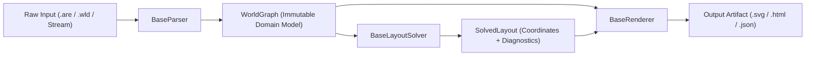

# Component Interfaces & Architecture Contracts

## Overview

ROMUtil decouples its architecture into three clean, independent subsystems:
1. **Parser (`BaseParser`)**: Ingests raw MUD area specifications across multiple dialects and formats into an immutable topology model (`WorldGraph`).
2. **Layout Solver (`BaseLayoutSolver`)**: Resolves topological relations into discrete 3D spatial coordinates (`SolvedLayout`), maintaining planarity, collision avoidance, and directional consistency.
3. **Renderer (`BaseRenderer`)**: Projects solved 3D graph layouts into target visual or structured formats (SVG, HTML, JSON).



---

## 1. Core Component Interfaces

All component protocols are defined in `romutil.interfaces` and decorated with `@runtime_checkable` for protocol inspection.

### `BaseParser`
```python
@runtime_checkable
class BaseParser(Protocol):
    """Protocol for area parsers constructing WorldGraph instances."""

    def parse(self, source: Path | str | TextIO) -> WorldGraph:
        """Parse raw MUD area content from a path, string, or stream into a WorldGraph."""
        ...
```
- **Responsibility**: Ingests area files or directories across MUD dialects (ROM 2.4, Merc 2.2, Envy 2.0, CircleMUD, DikuMUD Alfa, ACK!MUD, ANATOLIA, SMAUG).
- **Zero Spatial Concerns**: Parsers never compute layout coordinates, bounding boxes, or visual attributes.

### `BaseLayoutSolver`
```python
@runtime_checkable
class BaseLayoutSolver(Protocol):
    """Protocol for layout solvers computing 3D coordinates for a WorldGraph."""

    def solve(self, graph: WorldGraph, options: LayoutOptions | None = None) -> SolvedLayout:
        """Solve 3D spatial layout coordinates for the given WorldGraph."""
        ...
```
- **Responsibility**: Accepts a `WorldGraph` and optional `LayoutOptions`, computing an optimal or feasible embedding in integer 3D grid space.
- **Diagnostics**: Produces execution telemetry (`LayoutDiagnostics`) containing termination status (`SolverStatus`), run duration, defect metrics, and detailed solver statistics.

### `BaseRenderer`
```python
@runtime_checkable
class BaseRenderer(Protocol):
    """Protocol for renderers outputting solved layouts to visual or structured formats."""

    def render(
        self,
        graph: WorldGraph,
        layout: SolvedLayout,
        output_path: Path | str,
        options: RenderOptions | None = None,
    ) -> Path:
        """Render a solved layout of a WorldGraph to output_path."""
        ...
```
- **Responsibility**: Takes the immutable `WorldGraph` together with `SolvedLayout` coordinates, rendering visual maps or structured exports to disk.
- **Stateless Operation**: Renders without altering room definitions, exit attributes, or layout coordinates.

---

## 2. Value Objects and Data Contracts

All value objects in `romutil.types` are immutable dataclasses or enums.

### `Coord3D`
```python
@dataclass(frozen=True, slots=True)
class Coord3D:
    x: int
    y: int
    z: int
```
Represents an integer 3D grid point. Hashable and immutable.

### `WorldGraph`
```python
@dataclass(frozen=True)
class WorldGraph:
    rooms: Mapping[int, Room]
    exits: Sequence[Exit]
    header: AreaHeader | None = None

    @classmethod
    def from_area_data(cls, area: AreaData) -> WorldGraph:
        ...
```
Topological description of an area or collection of merged areas. Rooms are mapped by unique integer virtual number (`vnum`). Constructible directly or via factory method `WorldGraph.from_area_data(area)`.

### `SolverStatus`
```python
class SolverStatus(str, Enum):
    OPTIMAL = "optimal"
    FEASIBLE = "feasible"
    TIMEOUT = "timeout"
    INFEASIBLE = "infeasible"
```
Enumeration of solver termination statuses.

### `LayoutDiagnostics`
```python
@dataclass(frozen=True)
class LayoutDiagnostics:
    status: SolverStatus
    duration_seconds: float
    defect_count: int = 0
    details: Mapping[str, int] = field(default_factory=dict)
```
Diagnostic metadata returned alongside coordinates.

### `SolvedLayout`
```python
@dataclass(frozen=True)
class SolvedLayout:
    coordinates: Mapping[int, Coord3D]
    diagnostics: LayoutDiagnostics
```
Associates room vnums to their solved `Coord3D` positions.

### `LayoutOptions` & `RenderOptions`
```python
@dataclass(frozen=True)
class LayoutOptions:
    timeout_seconds: int = 60
    component_padding: int = 2

@dataclass(frozen=True)
class RenderOptions:
    split_levels: bool = False
    scale: float = 1.0
    theme: str = "default"
```
Configuration parameters for solver and rendering execution.

---

## 3. Design Invariants & Architectural Rules

1. **Strict Immutability**:
   - All value objects (`Coord3D`, `WorldGraph`, `LayoutDiagnostics`, `SolvedLayout`, `LayoutOptions`, `RenderOptions`) are `frozen=True`.
   - Modifying fields after instantiation raises `FrozenInstanceError`.

2. **Zero Monkey-Patching**:
   - Objects must not attach transient attributes at runtime (e.g., legacy `room.x`, `room.y`, `room.z`, `room.fixups`, `room.dummy`).
   - Coordinate positions reside exclusively in `SolvedLayout.coordinates`.

3. **Decoupled Responsibilities**:
   - Parsers have no layout logic.
   - Solvers have no file I/O or rendering logic.
   - Renderers consume `(WorldGraph, SolvedLayout)` and produce output artifacts without mutating inputs.
