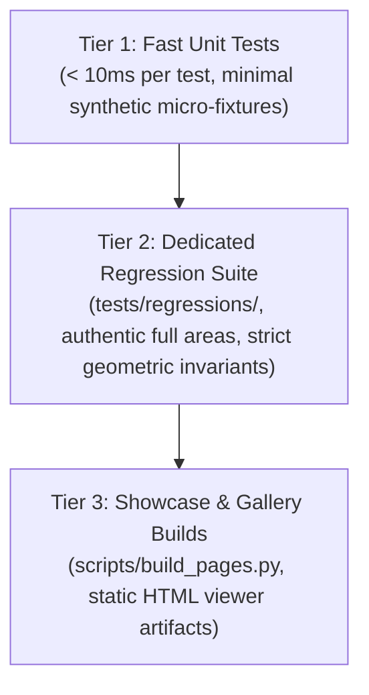

# ROMUtil Testing Architecture & Quality Standards

This document codifies the testing architecture, standards, and design invariants for the **ROMUtil** codebase. It defines how test suites are structured, how fixtures are authored, and how mathematical optimization and layout algorithms are verified.

---

## 1. Core Philosophy & Architectural Invariants

Layout optimization in ROMUtil involves Mixed-Integer Linear Programming (MILP), graph decomposition (SPQR, bridge-cut, topological cuts), and geometric coordinate reassembly. Because mathematical solvers (e.g., CBC, GLPK) perform combinatorial branch-and-bound exploration, test performance and architectural layering must be strictly preserved:

1. **Deterministic Execution**: Tests must execute deterministically without flaky timing dependencies or stochastic solver seeds.
2. **Layered Verification**: Tests must verify the appropriate architectural layer directly without unnecessary coupling to upstream parsers or downstream renderers.
3. **Zero Clearance / Collision Exemptions**: Layout tests verify strict geometric invariants (no overlapping room coordinates on the same elevation, no corridor segment penetrations through non-incident rooms).
4. **Evergreen Design**: Tests, docstrings, and comments must describe invariants, contracts, and mathematical behaviors rather than historical bug tickets, task identifiers, or transition phases.

---

## 2. The 3-Tier Testing Pyramid

ROMUtil organizes its automated test strategy into three distinct operational tiers:



### Tier 1: Fast Unit Tests

- **Target Runtime**: $< 10\text{ ms}$ per test case.
- **Fixture Strategy**: Minimal, in-memory synthetic micro-fixtures (4–8 rooms).
- **Scope**:
  - Algorithmic units (IR transformations, graph cuts, SPQR tree construction, geometry math, box union/intersection, coordinate transforms).
  - Isolated MILP cluster formulations on trivial topologies (e.g., 2–4 rooms, single cycle, T-junction).
  - Parser tokenization, AST generation, and serialization.
- **Rule**: **Never execute heavy branch-and-bound MILP solves on 100+ room authentic areas in unit tests.** Authentic area files must not be parsed and solved in unit tests simply to test isolated packing, traversal, or coordinate adjustment logic.

### Tier 2: Dedicated Regression Suite

- **Location**: `tests/regressions/` marked explicitly with `@pytest.mark.regression`.
- **Target Runtime**: Seconds per test case (run during integration verification and CI).
- **Scope**:
  - The **only** location where authentic full-area files (`midgaard.are`, `sewer.are`, `thalos.are`, `moria.are`, `midgaard_metropolitan`) are solved end-to-end.
  - Guards against historical defect recurrence with zero-tolerance geometric invariants:
    - **Zero Coordinate Collisions**: No two distinct rooms share identical `(x, y, z)` coordinates.
    - **Zero Corridor Penetrations**: 3D exit corridor segments never intersect or penetrate interior room bounding boxes.
    - **Axial Alignment**: Designated cardinal exits remain strictly perpendicular without unintended shear.
    - **Component Isolation**: Parallel branches and disconnected components maintain disjoint bounding envelopes without spatial voids.

### Tier 3: Showcase & Gallery Builds

- **Execution**: `uv run python scripts/build_pages.py --solver-timeout 10`.
- **Scope**:
  - End-to-end compilation of static site artifacts and interactive HTML viewers into `_site/`.
  - Validates full pipeline integration (Parser $\to$ Layout Engine $\to$ Renderers) and provides visual artifact inspection for reviewers.

---

## 3. Behavioral Contract Principle

Tests must verify **observable architectural contracts**, not transient internal implementation details:

### What to Test (Observable Contracts)
- `SolvedLayout.coordinates`: Correct relative or absolute room coordinates.
- `NodeSolution.bounding_box`: Accurate 3D bounding envelopes enclosing solved components.
- `SolvedLayout.diagnostics.status`: Solver status (e.g., `FEASIBLE`, `OPTIMAL`).
- `BoundingBox3D.overlaps`: Proper clearance and collision detection.
- `LayoutGraph` and `SolveTree` topology: Node types, parent-child relationships, cut edges, and boundary ports.

### What NOT to Test (Private Mathematical Internals)
- **Private Pyomo Variables & Models**: Never assert on private internal Pyomo variable containers (e.g., `model.s_transverse_p`, internal slack variables, or constraint naming schemes).
- Testing internal mathematical variable dictionaries creates fragile tests that break during solver formulation refactorings even when observable layout behavior is completely invariant.

---

## 4. Zero "Coverage Theater"

Code coverage metrics are a tool to identify untested business logic, not a goal to game through low-value tests.

- **Banned**: Mock tests or synthetic calls written solely to trigger defensive runtime `TypeError` or `ValueError` branches that static type checking (`mypy --strict`) already mathematically guarantees.
- **Banned**: Trivial mock-heavy unit tests that verify Python's attribute access rather than system behavior.
- **Required**: Tests must validate functional edge cases:
  - Empty or disconnected graphs.
  - Planar and non-planar cycles.
  - Multi-elevation transitions (`up` / `down` exits).
  - Asymmetric exit pairs and one-way doors.
  - Geometric collision boundaries and clearance planes.

---

## 5. Authoring Synthetic Micro-Fixtures

When writing unit tests for layout and decomposition logic, construct synthetic micro-fixtures in memory. This eliminates disk I/O, isolates algorithmic behavior, and guarantees sub-millisecond execution.

### Pattern: Minimal Linear Corridor or Component

```python
from romutil.models import Direction, Exit, Room
from romutil.types import WorldGraph


def make_test_room(vnum: int, exits: dict[Direction, int] | None = None) -> Room:
    exit_list = [
        Exit(direction=int(d), dst_vnum=dst)
        for d, dst in (exits or {}).items()
    ]
    return Room(
        vnum=vnum,
        name=f"Room {vnum}",
        description="",
        exits=tuple(exit_list),
    )


def build_linear_component(start_vnum: int, count: int) -> WorldGraph:
    """Creates an in-memory linear graph of connected rooms."""
    rooms: dict[int, Room] = {}
    for i in range(count):
        v = start_vnum + i
        exits: dict[Direction, int] = {}
        if i > 0:
            exits[Direction.west] = v - 1
        if i < count - 1:
            exits[Direction.east] = v + 1
        rooms[v] = make_test_room(v, exits)
    all_exits = [e for r in rooms.values() for e in r.exits]
    return WorldGraph(rooms=rooms, exits=all_exits)
```

### Pattern: Triconnected / SPQR Micro-Fixture (Wheel Graph)

To verify SPQR decomposition, triconnected core detection, or rigid cluster solving, use a 5-to-6 room wheel graph ($W_4$ or $W_5$) instead of parsing authentic areas like `school.are`:

```python
def build_wheel_graph() -> WorldGraph:
    """Creates a 5-node wheel graph (triconnected 3-block)."""
    # Central hub: 1. Perimeter cycle: 2 -> 3 -> 4 -> 5 -> 2.
    rooms = {
        1: make_test_room(1, {Direction.north: 2, Direction.east: 3, Direction.south: 4, Direction.west: 5}),
        2: make_test_room(2, {Direction.south: 1, Direction.east: 3, Direction.west: 5}),
        3: make_test_room(3, {Direction.west: 1, Direction.south: 4, Direction.north: 2}),
        4: make_test_room(4, {Direction.north: 1, Direction.west: 5, Direction.east: 3}),
        5: make_test_room(5, {Direction.east: 1, Direction.north: 2, Direction.south: 4}),
    }
    all_exits = [e for r in rooms.values() for e in r.exits]
    return WorldGraph(rooms=rooms, exits=all_exits)
```

---

## 6. Test Suite Execution & Standards

The test suite is managed via `uv` and `pytest`.

### Fast Unit Test Run
To execute all fast unit and contract tests while excluding heavy regression suites:
```bash
uv run pytest -m "not regression"
```

### Full Regression Suite Run
To execute the dedicated authentic area regression suite:
```bash
uv run pytest -m regression
```

### Complete Test Suite & Coverage
To run the full suite and generate test coverage reporting:
```bash
uv run pytest
```
*Requirement*: Total package coverage across `romutil/` must remain $\ge 95\%$.

### Pre-Commit Checks
All code, tests, and documentation must satisfy linting, type-checking, and hygiene standards:
```bash
uv run pre-commit run --all-files
```
